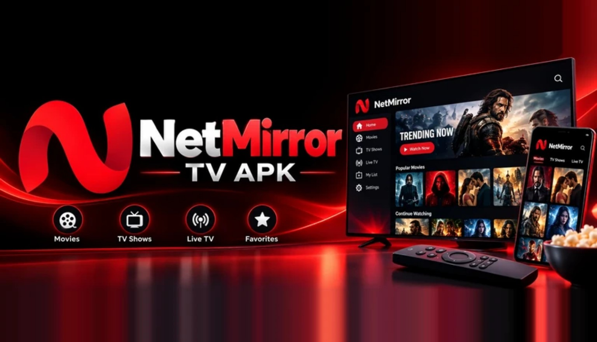
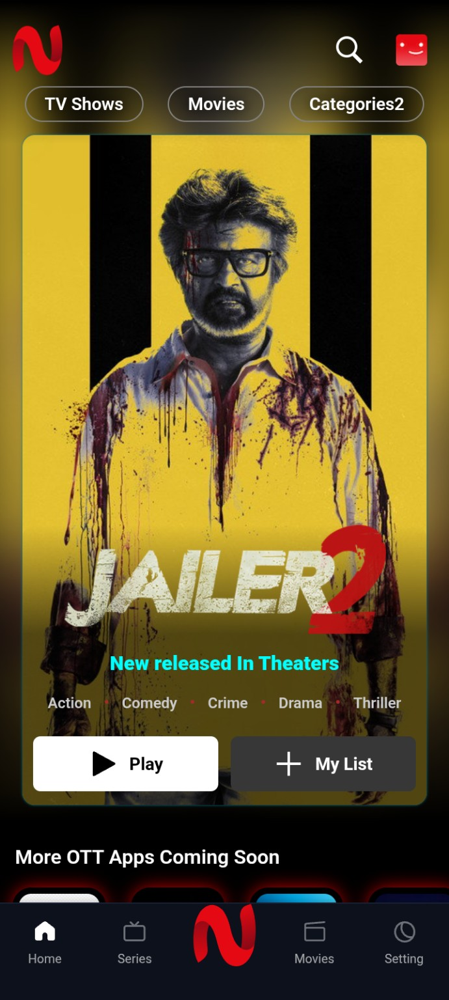
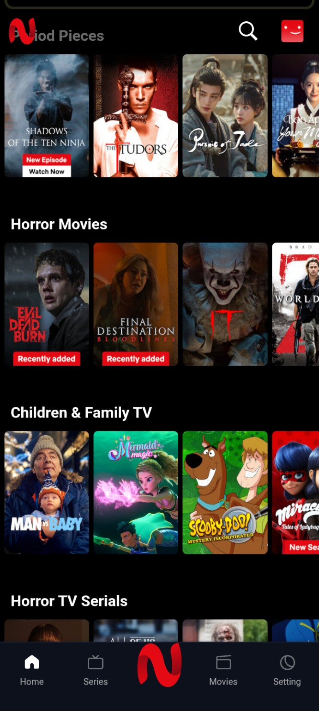
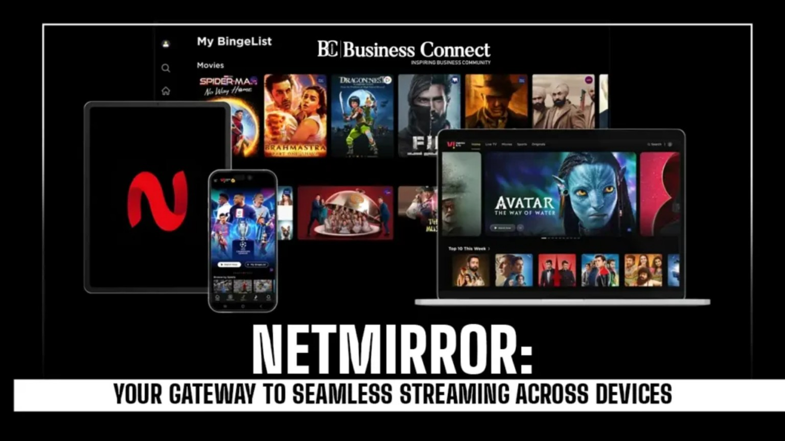

<div align="center">

# 🔴 NetMirror

### Stream Beyond Limits

**A cinematic streaming experience concept for Android phones and Android TV.**



<p>
  
  
  
</p>

**Movies • Series • Discover • Watchlist • Big-screen friendly UI**

</div>

---

## 📥 Download NetMirror APK

**[Open the latest APK releases](https://github.com/kambojkartik37-developer/NET_MIRROR/releases)** · **[Build status and logs](https://github.com/kambojkartik37-developer/NET_MIRROR/actions/workflows/build-netmirror-apk.yml)**

The repository now includes a GitHub Actions workflow that rebuilds the decoded Android project and publishes a debug-signed APK release when the build succeeds. If no release is available yet, open the Actions link and check the latest run.

> APK builds are debug-signed and are not production/official store releases. Install only if you trust the source and have the right to use and distribute the app.

## ✨ About the project

NetMirror is presented here as a **streaming app concept** with a bold black-and-red identity, cinematic artwork, and a layout designed to feel at home on both mobile screens and televisions.

The goal is a simple, visually engaging place to discover movies and series, browse categories, and keep a personal list of titles. On TV, the experience should be comfortable to navigate from a distance with a remote control.

> **Project note:** This README and the included screenshots describe the design shown in the supplied images. They do not claim that an Android APK, backend, streaming catalogue, or playback service is already implemented. Update the status and feature list to match the actual release.

## 📱 App preview

The screenshots and banner below are stored in the repository’s root `assets/` folder so they render directly on this GitHub page.

<div align="center">
  
  &nbsp;
  
</div>

<div align="center">
  <sub>Mobile interface concepts • Home, featured title, content rows and bottom navigation</sub>
</div>

## 📺 Designed for Android TV, too



The visual direction aims to scale from a phone to a living-room screen:

- **TV-friendly navigation:** clear sections and focus states suitable for D-pad and remote navigation.
- **Readable from a distance:** high-contrast text, bold labels and large artwork.
- **Wide-screen layouts:** landscape banners and horizontal content rails.
- **Consistent identity:** the same red, black and white visual language across devices.

*TV support depends on the implementation; the artwork alone does not establish Android TV compatibility.*

## 🚀 Planned highlights

- 🎬 **Movie discovery** — explore titles through a visual catalogue.
- 📺 **Series browsing** — find shows and browse episodes when supported.
- 🔎 **Search** — locate titles quickly.
- ⭐ **My List / Favorites** — save titles for later, if implemented.
- 🧭 **Genre rows** — browse sections such as action, comedy, drama, family and horror.
- 📱 **Mobile-first controls** — touch-friendly buttons and navigation.
- 🖥️ **Android TV layout** — remote-friendly focus and landscape presentation.
- 🌙 **Dark cinematic interface** — black backgrounds with vivid red highlights.

Features marked as planned should be changed to **Available** only after they work in the published build.

## 🧭 Project status

| Area | Status in this repository package |
|---|---|
| README and visual assets | Included |
| Mobile UI screenshots | Included |
| Decoded Android project | Included under `NetMirror-Android/NetMirror-smali/` |
| Android TV build | Not included in this package |
| Streaming backend / content rights | Not included in this package |
| APK download | Published to Releases after a successful Actions build |

The repository includes decoded Android resources/Smali and an automated Apktool rebuild workflow. A successful build is required before an installable APK appears under Releases.

## 🛠️ Suggested roadmap

- [ ] Build the Android application and responsive layouts.
- [ ] Add keyboard, D-pad and Android TV remote navigation.
- [ ] Implement search, categories and title details.
- [ ] Add a persistent watchlist and viewing progress.
- [ ] Connect a lawful catalogue and playback provider.
- [ ] Test on phones, tablets, Android TV devices and different screen sizes.
- [ ] Publish verified release APKs with checksums and release notes.
- [ ] Add accessibility labels, loading states and clear error messages.

## 🔐 Safety, privacy and content

- Use trusted distribution channels and review app permissions before installation.
- Publish a privacy policy that accurately explains any data collected.
- Only connect to streaming sources you are authorized to use.
- Ensure posters, logos, videos and other media are licensed or otherwise permitted.
- Do not publish API keys, signing credentials, tokens or private configuration in the repository.

## 📦 Repository contents

```text
netmirror-readme-package/
├── README.md
└── assets/
    ├── netmirror-banner.webp
    ├── netmirror-logo.webp
    ├── netmirror-devices.webp
    ├── app-home.png
    └── app-categories.png
```

## 🤝 Contributing

Suggestions, UI improvements, accessibility feedback and bug reports are welcome once the application source is added. Please include device model, Android version, steps to reproduce, and screenshots for UI issues. Never include personal information or secrets in a public issue.

## ⚖️ Disclaimer

NetMirror is used here as the project name shown in the supplied concept images. This README does not imply affiliation with Netflix or any other streaming service. Product names, logos and artwork may belong to their respective owners. The repository owner is responsible for verifying trademark use, distribution rights, and compliance with applicable laws.

---

<div align="center">

**Made for a bold, big-screen streaming vision. 🔴**

<sub>Replace this line with your repository owner's name, official project links, and verified release information before publishing.</sub>

</div>
